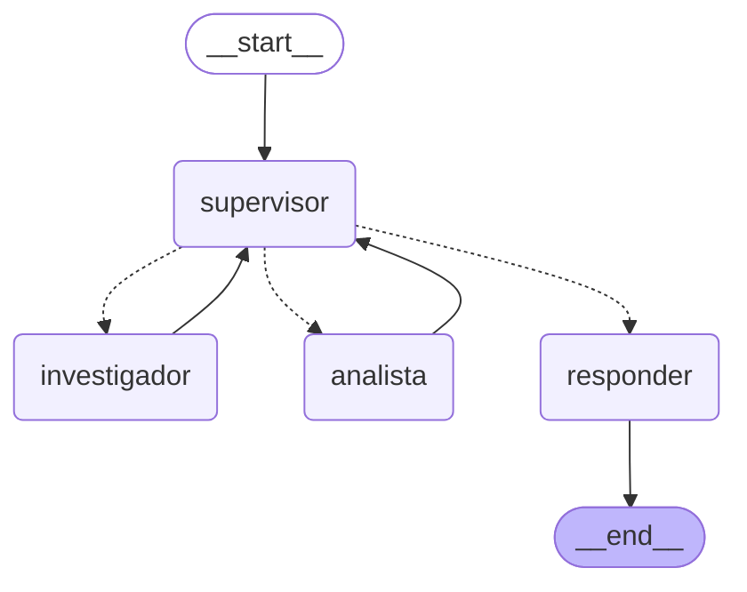

# Orquestador multi-agente con supervisor

Prototipo de un orquestador multi-agente construido con LangGraph. Un nodo **Supervisor**
recibe la consulta del usuario, decide dinámicamente qué especialista debe intervenir
(Investigador o Analista), valida los resultados con una rúbrica y recién entonces cierra
la conversación con una respuesta final.

## Estructura

| Archivo | Contenido |
|---|---|
| `state.py` | Estado compartido `EstadoOrquestador` (hereda de `MessagesState`) |
| `agents/research_agent.py` | Agente Investigador y sus herramientas de búsqueda |
| `agents/analyst_agent.py` | Agente Analista y sus herramientas de cálculo |
| `graph.py` | Supervisor, nodo de respuesta final y definición del grafo |
| `llm.py` | Configuración del LLM (Gemini) |
| `data.py` | Base de datos simulada de clientes y pedidos |
| `main.py` | Demo: ejecuta dos consultas y muestra el flujo de delegación |
| `demo.ipynb` | Notebook que demuestra el flujo de delegación, con la salida de una ejecución real |
| `traza_ejecucion.json` | Traza de la última ejecución (se genera al correr `main.py`) |
| `.env.example` | Plantilla de variables de entorno |

## Requisitos

- Python 3.12
- Una API key de Google Gemini (gratis en
  [aistudio.google.com/apikey](https://aistudio.google.com/apikey))

## Instalación

```powershell
python -m venv .venv
.venv\Scripts\Activate.ps1
pip install -r requirements.txt
```

## Variables de entorno

Copiá `.env.example` a `.env` y completá tu clave:

| Variable | Descripción |
|---|---|
| `GOOGLE_API_KEY` | Clave de Google AI Studio, usada por el LLM (Gemini) |

El archivo `.env` está en `.gitignore`: nunca se sube al repositorio.

## Ejecutar

```powershell
python main.py
```

Para volver a ejecutar el notebook `demo.ipynb` hace falta `pip install ipykernel`.

## Flujo de delegación (ejemplo)

Consulta: "Compará el gasto promedio por pedido de Ana García y Juan Pérez, y decime quién
gasta más por pedido."

1. **Supervisor → investigador.** Todavía no hay datos, así que primero hay que recopilarlos.
2. **Investigador.** Usa sus herramientas y devuelve los pedidos de Ana García (`[4200, 5300, 5000]`)
   y de Juan Pérez (`[3200]`).
3. **Supervisor → analista.** Ya hay datos, así que corresponde calcular y comparar.
4. **Analista.** Calcula los promedios ($4.833,33 y $3.200) y concluye que Ana García gasta
   un 51,04 % más por pedido.
5. **Supervisor → FINISH.** Verifica la rúbrica de validación y da la tarea por completa.
6. **Respuesta final.** Redacta la respuesta usando únicamente los aportes de los especialistas.

En la segunda consulta ("¿Cuál es el gasto promedio por pedido de Roberto Sánchez?") el
investigador informa que el cliente no existe, y el supervisor cierra directamente con
FINISH sin llamar al analista, siguiendo la rúbrica. La traza completa de ambas consultas
está en `traza_ejecucion.json`.

## Diagrama del grafo

Generado con `grafo.get_graph().draw_mermaid()`:



Las líneas punteadas son aristas condicionales: la función `enrutar` devuelve un
`Literal["investigador", "analista", "responder"]` según la decisión del supervisor.

## Topología elegida

Se eligió una **topología jerárquica con un supervisor central**: los especialistas nunca
se comunican entre sí, solo con el supervisor a través del estado compartido. Cada vez que
un especialista termina, el control vuelve al supervisor, que decide el siguiente paso.

Este diseño se eligió porque:

- Centraliza la decisión de flujo en un solo lugar, lo que hace que el comportamiento sea
  fácil de seguir y de depurar.
- Permite agregar especialistas nuevos sin tocar a los existentes: solo hay que sumar un
  nodo y una opción en la decisión del supervisor.
- Permite validar los resultados antes de responder y pedir un refinamiento si algo falla.

### Agentes

- **Supervisor.** Usa `with_structured_output` para devolver una `DecisionSupervisor`
  validada con Pydantic: a quién llamar (`investigador`, `analista` o `FINISH`), con qué
  instrucción y por qué.
- **Investigador.** Agente ReAct (`create_react_agent`) con dos herramientas:
  `buscar_cliente_por_nombre` y `obtener_pedidos_cliente`. Solo recopila datos.
- **Analista.** Agente ReAct con dos herramientas de cálculo: `calcular_estadisticas` y
  `calcular_diferencia_porcentual`. Solo calcula, y únicamente con los datos que le entrega
  el Investigador.

### Estado compartido

`EstadoOrquestador` hereda de `MessagesState` y agrega:

| Campo | Para qué sirve |
|---|---|
| `next_agent` | Decisión del supervisor, que usa la arista condicional |
| `instruccion` | Instrucción puntual para el especialista elegido |
| `task_completed` | Indica si el supervisor dio la tarea por completa |
| `pasos` | Contador de pasos del supervisor |
| `aportes` | Lista acumulable (`operator.add`) de qué agente aportó qué información |

El campo `aportes` permite rastrear la contribución de cada agente y evita perder contexto:
cada nodo devuelve solo sus cambios y el reducer los acumula, en lugar de modificar un
diccionario compartido.

### Validación

El supervisor tiene una **rúbrica de validación** en su prompt. Solo puede elegir `FINISH`
si se cumplen todos estos puntos:

1. El investigador aportó datos concretos para todo lo pedido, o informó que no existen.
2. Si hacían falta cálculos, el analista los hizo con herramientas.
3. Los números del análisis provienen de los datos del investigador y no los contradicen.
4. Ningún aporte contiene errores sin resolver ni datos inventados.

Si algún punto falla, el supervisor reenvía la tarea al especialista que corresponda con una
instrucción de corrección.

### Manejo de conflictos entre agentes

- **Autoridad única.** El supervisor es el único que decide el flujo, por lo que dos
  especialistas nunca compiten por actuar.
- **Roles acotados.** Cada especialista tiene herramientas distintas y un prompt que le
  prohíbe invadir el rol del otro (el analista no busca datos y el investigador no calcula).
- **Consistencia verificada.** La rúbrica exige que los números del analista coincidan con
  los datos del investigador. Si se contradicen, el supervisor devuelve la tarea al analista.
- **Sin bucles infinitos.** El contador `pasos` limita al supervisor a `MAX_PASOS = 6`
  decisiones: al llegar al límite fuerza el cierre con la información disponible. Además,
  la ejecución define `recursion_limit=25`.

### Contexto acotado

Los especialistas no reciben todo el historial. El investigador recibe solo la instrucción
del supervisor, y el analista recibe la instrucción más los datos del investigador. Así se
evita contaminar el contexto con información que no necesitan.
