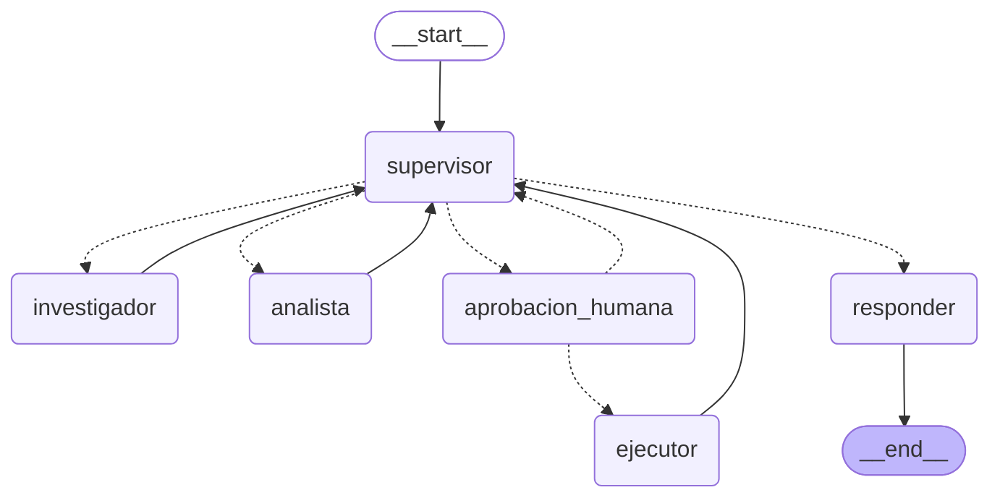
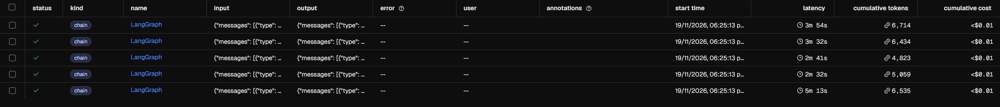
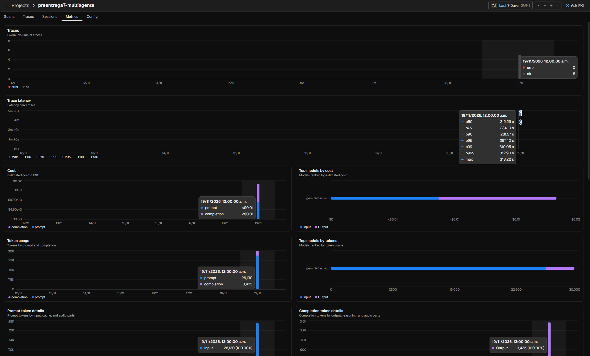
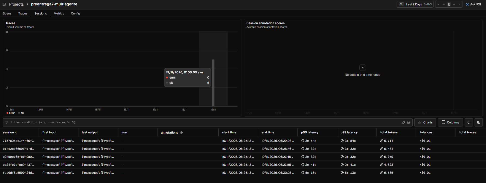
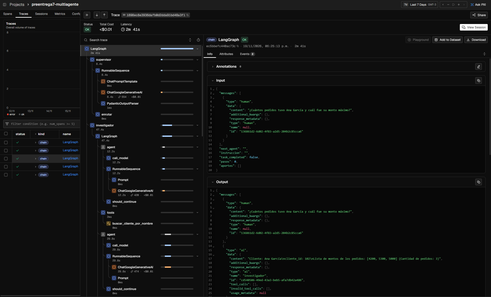

# API de producción y monitoreo activo para el sistema multi-agente

API REST con FastAPI que expone el orquestador multi-agente del Módulo 6, con:

- **Endpoints asíncronos**: `POST /tasks` encola la tarea y devuelve un `job_id` sin bloquear.
- **Redis**: guarda el estado de cada job y los checkpoints de LangGraph (`AsyncRedisSaver`).
- **Observabilidad**: trazas de cada nodo del grafo en Arize Phoenix (OpenInference).
- **Human-in-the-loop**: las acciones críticas pausan el grafo hasta recibir una aprobación externa.
- **Prueba de carga**: script con 5 peticiones concurrentes.

## Estructura

```
preEntrega7/
├── app/
│   ├── main.py             FastAPI: POST /tasks, GET /tasks/{id}, GET /health
│   ├── graph.py            Orquestador multi-agente (supervisor + 3 especialistas + HITL) y checkpointer
│   ├── worker.py           Workers en segundo plano: ejecutan el grafo y actualizan el estado en Redis
│   ├── jobs.py             Estado de los jobs en Redis (PENDING / RUNNING / WAITING_APPROVAL / DONE / FAILED)
│   ├── hitl.py             Nodo de aprobación humana (interrupt) y endpoint POST /tasks/{id}/approve
│   ├── observability.py    Inicialización de Arize Phoenix
│   ├── state.py, data.py, llm.py
│   └── agents/             investigador, analista y ejecutor
├── scripts/
│   ├── load_test.py        5 peticiones concurrentes + latencias p50 / p95
│   └── demo_hitl.py        Demo del flujo de aprobación humana
├── screenshots/            Capturas del dashboard de Phoenix
├── Dockerfile
├── docker-compose.yml      Redis Stack + Phoenix + API (opcional)
├── requirements.txt
├── .env.example
└── README.md
```

## Arquitectura



El flujo de una petición:

1. `POST /tasks` crea el job en Redis con estado `PENDING`, lo mete en una cola
   (`asyncio.Queue`) y responde `202` con el `job_id`. El endpoint no espera al LLM.
2. Un worker toma el job, lo pasa a `RUNNING` y ejecuta el grafo. El `job_id` se usa como
   `thread_id`, así que cada paso del grafo queda guardado como checkpoint en Redis.
3. Al terminar, el job pasa a `DONE` con el resultado. Si el grafo lanza una excepción, el
   worker la captura y deja el job en `FAILED` con el mensaje de error, para que el cliente
   no quede esperando indefinidamente.
4. El cliente consulta `GET /tasks/{job_id}` hasta ver un estado final.

### Estados de un job

| Estado | Significado |
|---|---|
| `PENDING` | Encolado, todavía no lo tomó ningún worker |
| `RUNNING` | Un worker está ejecutando el grafo |
| `WAITING_APPROVAL` | El grafo está pausado esperando una aprobación humana |
| `DONE` | Terminó. El resultado está en `resultado` |
| `FAILED` | Falló. El error está en `error` |

### Human-in-the-loop

El supervisor puede enviar una tarea al agente **ejecutor**, que realiza acciones con
efectos secundarios reales (por ejemplo, `aplicar_descuento`). Esas acciones se consideran
**críticas**, así que el grafo nunca llega al ejecutor directamente: pasa por el nodo
`aprobacion_humana`, que llama a `interrupt()` y pausa la ejecución.

- El job queda en `WAITING_APPROVAL` y el detalle de lo que se quiere ejecutar está en
  `aprobacion_pendiente`.
- `POST /tasks/{job_id}/approve` con `{"aprobado": true | false, "comentario": "..."}`
  reanuda el grafo con `Command(resume=...)`.
- Si se aprueba, el ejecutor corre la herramienta. Si se rechaza, el supervisor cierra
  informando el rechazo y la acción no se ejecuta.

Como el estado vive en los checkpoints de Redis, la pausa sobrevive a un reinicio de la API.

## Requisitos

- Python 3.12
- Una API key de Google Gemini (gratis en [aistudio.google.com/apikey](https://aistudio.google.com/apikey))
- Redis **con los módulos RediSearch y RedisJSON** (Redis Stack). El checkpointer de LangGraph
  los necesita, así que un Redis común no alcanza.

## Instalación

```powershell
python -m venv .venv
.venv\Scripts\Activate.ps1
pip install -r requirements.txt
```

Copiá `.env.example` a `.env` y completalo:

| Variable | Descripción |
|---|---|
| `GOOGLE_API_KEY` | Clave de Google AI Studio |
| `REDIS_URL` | URL de Redis, por ejemplo `redis://localhost:6379` |
| `PHOENIX_COLLECTOR_ENDPOINT` | URL de Phoenix, por defecto `http://localhost:6006` |
| `PHOENIX_PROJECT_NAME` | Nombre del proyecto en Phoenix |
| `NUM_WORKERS` | Cantidad de workers concurrentes (por defecto 5) |
| `LLM_REQUESTS_PER_SECOND` | Ritmo máximo de llamadas al LLM (por defecto 0.2, o sea 12 por minuto) |

El archivo `.env` está en `.gitignore`: nunca se sube al repositorio.

## Levantar Redis

**Opción A: Docker Compose** (levanta Redis Stack, Phoenix y la API juntos):

```powershell
docker compose up --build
```

La API queda en `http://localhost:8000` y Phoenix en `http://localhost:6006`. En este caso,
saltá a [Probar la API](#probar-la-api).

**Opción B: Redis Cloud (gratis, sin instalar nada).**

1. Creá una cuenta en [redis.io/cloud](https://redis.io/cloud) y una base de datos gratuita.
2. Copiá la URL de conexión (`redis://default:<password>@<host>:<puerto>`).
3. Pegala en `REDIS_URL` dentro del `.env`.

**Opción C: Redis Stack propio** (por ejemplo, con Docker):

```powershell
docker run -d --name redis-stack -p 6379:6379 redis/redis-stack-server:latest
```

## Levantar Phoenix y la API

En una terminal, el panel de monitoreo:

```powershell
phoenix serve
```

Queda en `http://localhost:6006`. En otra terminal, la API (desde la carpeta `preEntrega7`):

```powershell
uvicorn app.main:app --port 8000
```

Comprobá que todo conecta con `GET http://localhost:8000/health`.

## Probar la API

Crear una tarea:

```powershell
curl.exe -X POST http://localhost:8000/tasks -H "Content-Type: application/json" -d '{\"pregunta\": \"Compará el gasto promedio por pedido de Ana García y Juan Pérez\"}'
```

Consultar su estado con el `job_id` recibido:

```powershell
curl.exe http://localhost:8000/tasks/<job_id>
```

### Probar el flujo de aprobación humana

```powershell
python scripts/demo_hitl.py
python scripts/demo_hitl.py --rechazar
```

El script pide aplicar un descuento, espera a que el job quede en `WAITING_APPROVAL`, muestra
lo que se quiere ejecutar y envía la aprobación (o el rechazo). También se puede hacer a mano
con `POST /tasks/{job_id}/approve`.

## Prueba de carga: 5 peticiones concurrentes

Con la API y Phoenix levantados:

```powershell
python scripts/load_test.py
```

El script lanza 5 consultas al mismo tiempo, espera a que cada una termine y muestra el
tiempo de cada petición y las latencias p50, p95 y máxima.

### Límite de cuota del LLM

El plan gratuito de Gemini permite unas 15 solicitudes por minuto, y cada job hace alrededor
de 10 llamadas al modelo. Con 5 jobs en paralelo, la primera versión de la prueba terminó con
los 5 jobs en `FAILED` por un error `429 RESOURCE_EXHAUSTED` (que además confirmó que el paso
a `FAILED` en Redis funciona). Para resolverlo se agregó un limitador de ritmo del lado del
cliente (`InMemoryRateLimiter` en `app/llm.py`): los 5 jobs entran concurrentes, pero las
llamadas al LLM salen a un máximo de 12 por minuto. Por eso cada job tarda minutos y no
segundos. Con una cuenta de pago se puede subir `LLM_REQUESTS_PER_SECOND`.

### Resultado de la corrida

| Métrica | Valor |
|---|---|
| Peticiones concurrentes | 5 |
| Terminadas OK / fallidas | 5 / 0 |
| Latencia p50 | 214,4 s |
| Latencia p95 | 298,9 s |
| Latencia máxima | 314,7 s |

Latencias medidas por el cliente (`load_test.py`) desde que envía la petición hasta que el job
termina, con el plan gratuito de Gemini y el limitador de ritmo activo. Phoenix, midiendo las
trazas del lado del servidor, informa valores casi idénticos (p95 de 297,4 s).

### Lectura del dashboard

Datos de las 5 ejecuciones, tomados de Phoenix:

| Métrica | Valor |
|---|---|
| Trazas / spans | 5 / 357 |
| Llamadas al LLM | 48 |
| Tokens (entrada + salida) | 26.130 + 3.435 = 29.565 |
| Costo total estimado | US$ 0,0164 (unos US$ 0,0033 por ejecución) |

- **Dónde se concentra la latencia.** Casi todo el tiempo está en las llamadas al LLM. Las
  herramientas (`buscar_cliente_por_nombre`, `calcular_estadisticas`, etc.) tardan
  milisegundos. Una sola llamada del supervisor puede demorar decenas de segundos porque
  espera su turno en el limitador de ritmo.
- **Qué nodo consume más tokens.** El supervisor (34 %), seguido por el analista (32 %) y el
  investigador (27 %). El nodo de respuesta final consume solo el 6 %. El supervisor gasta
  más porque se invoca varias veces por job (una al inicio y otra después de cada especialista)
  y en cada una recibe los aportes acumulados.
- **Costo.** Phoenix lo calcula a partir de los tokens de entrada y salida y de su tabla de
  precios por modelo. Como `gemini-flash-lite-latest` es un alias, usa la tarifa de un modelo
  Gemini Flash, así que el valor es una estimación y no el precio exacto de Google.

### Hallazgo de la observabilidad

En una corrida anterior, la traza de un job mostró que el investigador respondía "no se
encontró ningún cliente" para "Maria Lopez": el modelo había escrito el nombre sin tilde y la
búsqueda era sensible a los acentos. Se corrigió haciendo que `buscar_cliente_por_nombre`
ignore tildes y mayúsculas, y la corrida de arriba se repitió con el código corregido.

Después, abrí Phoenix en `http://localhost:6006`, entrá al proyecto
`preentrega7-multiagente` y revisá:

- **Trazas**: solo se instrumenta LangChain/LangGraph (no la capa HTTP de FastAPI), así que
  el proyecto contiene una traza por job y las métricas del panel no se mezclan con las
  consultas de polling. Cada job es una traza con un span por nodo del grafo (`supervisor`,
  `investigador`, `analista`, `responder`) y por cada llamada al LLM. Los spans de un mismo
  job comparten la sesión `job_id`.
- **Latencia**: en el árbol de cada traza se ve en qué nodo se concentra el tiempo.
- **Tokens y costo**: Phoenix calcula el costo de cada llamada a partir de los tokens de
  entrada y salida y la tabla de precios del modelo. Si el modelo usado no figura en esa
  tabla, la columna de costo queda vacía: en ese caso hay que agregarlo en
  *Settings → Models*, con sus precios por millón de tokens.
- **Latencia p95**: si la versión de Phoenix no muestra el percentil 95, se obtiene del
  script `load_test.py`, que lo calcula sobre las 5 peticiones.

## Evidencia (capturas del dashboard)

Capturas de la corrida de 5 peticiones concurrentes, en `screenshots/`:

| Archivo | Qué muestra |
|---|---|
| `1_trazas.png` | Las 5 trazas, con su latencia, tokens y costo acumulados |
| `2_metricas.png` | Percentiles de latencia (p95 = 297,40 s), costo y tokens del proyecto |
| `3_sesiones.png` | Una sesión por job, con latencia, tokens y costo |
| `4_traza_detalle.png` | Árbol de una traza: nodos del grafo, llamadas al LLM y herramientas |






El flujo de aprobación humana se verificó de punta a punta contra Redis: el job queda en
`WAITING_APPROVAL`, y tras `POST /tasks/{id}/approve` termina en `DONE` con la acción ejecutada
(si se aprueba) o sin ejecutarla (si se rechaza).

## Decisiones de diseño

- **Worker en el mismo proceso.** Los workers son tareas asíncronas (`asyncio`) que
  consumen una cola en memoria. Es simple y suficiente para esta etapa; para escalar a varios
  procesos o máquinas habría que reemplazar la cola por Arq o Celery sobre el mismo Redis.
- **Estado en dos lugares.** El estado del *job* (lo que ve el cliente) y los *checkpoints*
  del grafo (lo que necesita LangGraph para pausar y reanudar) se guardan en Redis, pero por
  separado.
- **Errores en segundo plano.** Cualquier excepción del grafo se captura en el worker y
  deja el job en `FAILED`, en lugar de perderse en una tarea sin supervisión.
- **Sin bloqueos.** Todo el camino es asíncrono: cliente de Redis (`redis.asyncio`),
  checkpointer (`AsyncRedisSaver`) y llamadas al LLM (`ainvoke`).
